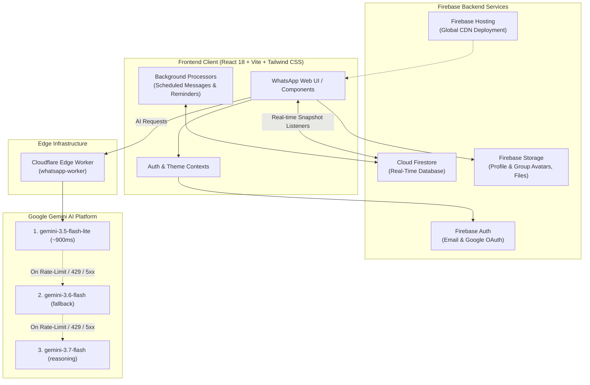

# 💬 WhatsApp Clone — Full-Featured Real-Time Chat Platform

<p align="center">
  
</p>

<p align="center">
  <strong>A production-ready, highly responsive WhatsApp Web replica powered by React, TypeScript, Firebase, and Gemini AI edge intelligence.</strong>
</p>

<p align="center">
  <em>Built with passion for the <strong>Vibe Hackathon</strong> 🚀</em>
</p>

<p align="center">
  <a href="https://whatsapp-hackthon.web.app/" target="_blank">
    
  </a>
  <a href="https://github.com/Naseem2917/WhatsApp/blob/main/LICENSE">
    
  </a>
  
  
  
  
  
</p>

<p align="center">
  <a href="https://whatsapp-hackthon.web.app/">🌐 <strong>Explore Live Application</strong></a> •
  <a href="#-getting-started">🚀 <strong>Quick Start</strong></a> •
  <a href="#-features">✨ <strong>Key Features</strong></a> •
  <a href="#-system-architecture">🏗️ <strong>Architecture</strong></a> •
  <a href="#-team--contributors-vibe-hackathon">👥 <strong>Team</strong></a>
</p>

---

## 📑 Table of Contents

- [Overview](#-overview)
- [Key Features](#-key-features)
  - [Authentication & User Management](#-authentication--user-management)
  - [Real-Time Messaging](#-real-time-messaging)
  - [Message Actions & Reactions](#-message-actions--reactions)
  - [Group Collaboration & Management](#-group-collaboration--management)
  - [AI Intelligence Suite (Gemini API)](#-ai-intelligence-suite-gemini-api)
  - [Scheduled Messages & Message Reminders](#-scheduled-messages--message-reminders)
  - [UI/UX & Accessibility](#-uiux--accessibility)
- [System Architecture](#-system-architecture)
- [Tech Stack](#-tech-stack)
- [Database & Security Rules](#-database--security-rules)
- [Cloudflare Edge Worker & Multi-Model AI Fallback](#-cloudflare-edge-worker--multi-model-ai-fallback)
- [Getting Started](#-getting-started)
  - [Prerequisites](#prerequisites)
  - [Installation](#installation)
  - [Environment Variables](#environment-variables)
  - [Setting Up Cloudflare Worker (Optional Local Run)](#setting-up-cloudflare-worker-optional-local-run)
  - [Running the Application](#running-the-application)
- [Project Structure](#-project-structure)
- [Available Scripts](#-available-scripts)
- [Design Decisions & Resource Optimizations](#-design-decisions--resource-optimizations)
- [Roadmap](#-roadmap)
- [Team & Contributors (Vibe Hackathon)](#-team--contributors-vibe-hackathon)
- [Contributing](#-contributing)
- [License](#-license)

---

## 🌟 Overview

**WhatsApp Clone** is a modern, high-performance web chat platform that authentically replicates the look, feel, and fluid responsiveness of WhatsApp Web while augmenting it with next-generation **Generative AI capabilities**.

Engineered for the **Vibe Hackathon**, this project demonstrates how to combine **Firebase Firestore real-time listeners**, **Cloudflare Edge Workers**, and **Google Gemini models** to deliver lightning-fast direct and group messaging, rich media sharing, message scheduling, smart reminders, and context-aware AI utilities.

### 🎯 Key Highlights
- **100% Real-Time**: Instant message synchronization and typing presence using snapshot listeners.
- **AI-Powered Productivity**: Rewrite messages into 11 distinct tones, summarize lengthy chats, extract action items, and generate full multi-origin group travel itineraries.
- **Zero-Latency Resilience**: Edge-hosted multi-model fallback chain (`gemini-3.5-flash-lite` ➔ `gemini-3.6-flash` ➔ `gemini-3.7-flash`).
- **Production Security**: Strict Firestore and Firebase Storage security rules restricting access exclusively to authenticated participants.
- **Free-Tier Friendly**: Built-in client-side message scheduling, background reminder processor, and client-side image compression.

---

## ✨ Key Features

### 🔐 Authentication & User Management
- **Firebase Authentication**: Email/Password signup and instant Google OAuth social login.
- **Custom User Onboarding**: Mandatory first-time onboarding step to pick a unique `@username`, phone number, and location.
- **Profile Customization**: Update display name, custom avatar with storage upload, bio ("About"), and location settings.
- **Live Presence & Heartbeat**: Real-time online/offline indicator with `OnlineStatusHeartbeat` and accurate `lastSeen` tracking.

### 💬 Real-Time Messaging
- **Direct & Group Chats**: Seamless 1-on-1 private channels and multi-member group conversations.
- **Delivery & Read Receipts**: Visual message status flow:
  - 🕒 Pending / sending
  - ✓ Sent to server
  - ✓✓ Delivered to recipient
  - <span style="color:#53bdeb;">✓✓</span> Blue ticks when read by participants.
- **Typing Indicators**: Real-time feedback displaying when peers are typing.
- **Unread Counters & Tab Badges**: Visual count badges per chat item and dynamic unread counts in the browser document title (`(3) WhatsApp`).
- **In-Chat Search**: Instant filter and search through conversation history.

### 😀 Message Actions & Reactions
- **Quick Emoji Reactions**: Floating toolbar for one-tap reactions (`👍`, `❤️`, `😂`, `😮`, `😢`, `🙏`).
- **Comprehensive Emoji Picker**: Integrated `emoji-picker-react` modal for full emoji range.
- **Contextual Quote & Reply**: Visual quote banner directly previewed above the text input bar.
- **Forwarding Modal**: Forward any message to another conversation or group with a dedicated selector.
- **Message Pinning & Starred Items**: Pin critical messages to conversation headers and bookmark important notes with ⭐.
- **Soft Deletion & Copy**: Clean clipboard copy utility and soft message removal for senders.
- **Private Group Replies**: Reply privately in 1-on-1 chats directly from group thread contexts.

### 👥 Group Collaboration & Management
- **Interactive Group Creator**: Create groups with custom names, custom avatars, and multi-user participant pickers.
- **Role-Based Group Administration**: Designate admins, promote participants, or remove members.
- **Distinct Participant Colors**: Auto-assigned participant name colors for visual clarity in busy threads.
- **Group Metadata Panel**: Inspect members, participant locations, timestamps, and admins at a glance.

### 🤖 AI Intelligence Suite (Gemini API)
Powered by a dedicated Cloudflare Worker edge proxy communicating with the Google Gemini API:

| AI Feature | Description |
|:---|:---|
| **✨ Multi-Tone Message Rewrite** | Rewrites drafts across **11 tones**: *Professional, Casual, Short, Polite, Friendly, Romantic, Funny, Formal, Hinglish, Expand, and Grammar Fix*. |
| **📑 Conversation Summarizer** | Analyzes chat history and generates structured summaries covering key decisions, dates, tasks, and discussion points. |
| **⚡ Context-Aware Smart Replies** | Inspects recent dialog and suggests 3 quick-response buttons for one-tap answers. |
| **✈️ Group Trip Planner** | Parses group chat discussions and generates full travel plans with multi-city departure plans, itineraries, checklists, and meeting spots. |
| **🎯 Priority & Importance Detection** | Identifies critical unread messages requiring immediate action, questions, or pending deadlines. |

### ⏰ Scheduled Messages & Message Reminders
- **Future Message Scheduling**: Draft messages with custom delivery dates and times.
- **Message Reminders**: Flag specific messages to trigger timely personal reminders and dismissal alerts.
- **Client-Side Background Engine**: `ScheduledMessageProcessor` and `ReminderProcessor` monitor timestamps and deliver payloads without requiring paid Cloud Functions.

### 🎨 UI/UX & Accessibility
- **Faithful WhatsApp Web Aesthetics**: Custom color schemes, chat wallpaper, message bubbles, and responsive layouts.
- **Dark & Light Mode**: Seamless theme switching with persistent user preferences stored in `localStorage`.
- **Responsive Layout**: Fluid transition between mobile single-pane view and desktop three-column interface (Sidebar, Conversation, Detail Panel).
- **Smooth Micro-Interactions**: Hover menus, drop-down action sheets, subtle loading skeletons, and smooth scroll anchors.

---

## 🏗️ System Architecture



---

## 🛠️ Tech Stack

### Frontend & Core
| Technology | Version | Description |
|:---|:---|:---|
| **React** | `^18.3.1` | Declarative component-based UI architecture |
| **TypeScript** | `~5.6.2` | Type-safe development with strict interfaces |
| **Vite** | `^6.0.5` | Next-generation frontend build tool and HMR server |
| **Tailwind CSS** | `^3.4.17` | Utility-first CSS framework with customized WhatsApp theme |
| **React Router** | `^7.1.1` | Client-side routing with protected route guards |
| **emoji-picker-react** | `^4.16.1` | Feature-rich emoji selection palette |

### Backend, Database & Cloud
| Technology | Version | Description |
|:---|:---|:---|
| **Firebase Auth** | `^11.1.0` | Secure email/password and Google social authentication |
| **Cloud Firestore** | `^11.1.0` | NoSQL document database with real-time websocket subscriptions |
| **Firebase Storage** | `^11.1.0` | Cloud blob storage for profile and group media |
| **Firebase Hosting** | Latest | High-availability global CDN hosting |

### Edge Proxy & AI Engine
| Technology | Description |
|:---|:---|
| **Cloudflare Workers** | Edge compute runtime proxying AI requests and securing API keys |
| **Google Gemini API** | Multi-model Generative AI powering text rewrites, summaries, and trip plans |
| **Wrangler** | CLI for configuring and deploying Cloudflare Worker routines |

---

## 🗄️ Database & Security Rules

The application utilizes a secure, normalized Firestore schema with strict access controls:

### Collections Schema
- `/users/{userId}`: Stores user profile (`username`, `email`, `displayName`, `photoURL`, `isOnline`, `lastSeen`, `location`).
- `/chats/{chatId}`: Stores conversation meta (`participants`, `isGroup`, `groupName`, `groupPhoto`, `admins`, `lastMessage`, `unreadCount`).
  - `/chats/{chatId}/messages/{messageId}`: Message subcollection (`senderId`, `content`, `status`, `timestamp`, `reactions`, `starredBy`, `isPinned`, `replyTo`).
- `/scheduledMessages/{messageId}`: Scheduled queue items (`senderId`, `chatId`, `content`, `scheduledFor`, `status`).
- `/reminders/{reminderId}`: User-specific reminder entries (`userId`, `chatId`, `messageId`, `reminderTime`, `status`).

### Security Architecture Highlights
- **Document Ownership**: Users can only modify their own profile data.
- **Participant Access Protection**: Chats and messages can strictly be read or updated by confirmed chat participants.
- **Message Immutability**: Hard deletion of messages is blocked; messages support controlled soft-delete.
- **Scheduled & Reminder Scoping**: Users can only query and mutate scheduled items or reminders belonging to their authenticated `uid`.

---

## 🌐 Cloudflare Edge Worker & Multi-Model AI Fallback

To prevent API key leakage in client bundles and avoid downtime during API rate-limits, all AI traffic is routed through a resilient Cloudflare Worker:

```typescript
/**
 * 3-Tier Multi-Model Fallback Chain:
 * 1. gemini-3.5-flash-lite  --> Ultra-fast response (~900ms)
 * 2. gemini-3.6-flash       --> Rate-limit / transient error failover
 * 3. gemini-3.7-flash       --> Complex reasoning & final failover
 */
```

### Worker Endpoints
- `GET /health`: Healthcheck endpoint reporting active fallback models and environment status.
- `POST /api/summarize`: Generates structured conversation highlights.
- `POST /api/importance`: Returns IDs of high-priority messages.
- `POST /api/smart-reply`: Returns 3 contextually relevant short replies.
- `POST /api/trip-plan`: Synthesizes travel plans from participants' chat context.
- `POST /`: Core rewrite and generation endpoint supporting all 11 tone variations.

---

## 🚀 Getting Started

### Prerequisites
Ensure your local environment has the following tools installed:
- **Node.js**: v18.0.0 or higher
- **npm** (v9+) or **yarn**
- A **Firebase account** with Firestore, Authentication, and Storage configured.
- (Optional) A **Google AI Studio** Gemini API Key and Cloudflare account.

---

### Installation

1. **Clone the repository:**
   ```bash
   git clone https://github.com/Naseem2917/WhatsApp.git
   cd WhatsApp
   ```

2. **Install frontend dependencies:**
   ```bash
   npm install
   ```

3. **Configure environment variables:**
   ```bash
   # Copy sample environment configuration
   cp .env.example .env
   ```

---

### Environment Variables

Edit `.env` (or `.env.local`) and configure your Firebase project credentials:

| Variable | Description | Example / Default |
|:---|:---|:---|
| `VITE_FIREBASE_API_KEY` | Firebase Web API Key | `AIzaSy...` |
| `VITE_FIREBASE_AUTH_DOMAIN` | Firebase Authentication Domain | `your-app.firebaseapp.com` |
| `VITE_FIREBASE_PROJECT_ID` | Firebase Project ID | `whatsapp-hackthon` |
| `VITE_FIREBASE_STORAGE_BUCKET` | Firebase Storage Bucket URI | `your-app.firebasestorage.app` |
| `VITE_FIREBASE_MESSAGING_SENDER_ID` | FCM Messaging Sender ID | `123456789012` |
| `VITE_FIREBASE_APP_ID` | Firebase Web Application ID | `1:123456:web:abcd...` |
| `VITE_WORKER_URL` | Cloudflare Worker AI Endpoint | `https://whatsapp.naseem2917.workers.dev` |

---

### Setting Up Cloudflare Worker (Optional Local Run)

If you wish to run the AI Edge Worker locally:

```bash
cd worker
npm install

# Test worker locally with Wrangler (runs on http://localhost:8787)
npx wrangler dev
```

To deploy your own worker to Cloudflare:
```bash
# Set your Gemini API key secret in Cloudflare
npx wrangler secret put GEMINI_API_KEY

# Deploy worker
npx wrangler deploy
```

---

### Running the Application

Start the local Vite development server:
```bash
npm run dev
```

Open your browser and navigate to **[http://localhost:5173](http://localhost:5173)**.

---

## 📁 Project Structure

```text
c:/WhatsApp/WhatsApp/
├── public/                     # Static assets (whatsapp-icon.svg, whatsapp-logo.svg)
├── worker/                     # Cloudflare Edge Worker
│   ├── src/
│   │   └── index.ts            # Gemini AI proxy with 3-model fallback
│   ├── wrangler.toml           # Cloudflare configuration
│   └── package.json
├── src/
│   ├── components/
│   │   ├── chat/               # Chat-specific components
│   │   │   ├── AIFeaturesPanel.tsx        # Comprehensive AI tool drawer
│   │   │   ├── AIPanel.tsx                # Context-aware AI insights drawer
│   │   │   ├── AIRewriteModal.tsx         # 11-Tone message rewrite modal
│   │   │   ├── AISuggestionBar.tsx        # One-click prompt suggestion bar
│   │   │   ├── ConversationSummaryModal.tsx
│   │   │   ├── CreateGroupModal.tsx       # Group creation & avatar upload
│   │   │   ├── ForwardModal.tsx           # Multi-chat message forwarder
│   │   │   ├── GroupInfoPanel.tsx         # Participant & admin management
│   │   │   ├── MessageActionMenu.tsx      # Reactions, reply, pin, delete menu
│   │   │   ├── NewChatModal.tsx           # User search & direct chat creation
│   │   │   ├── ScheduleMessageModal.tsx   # Message delivery scheduler
│   │   │   ├── SetReminderModal.tsx       # Message reminder picker
│   │   │   ├── SmartRepliesPanel.tsx      # AI reply pill buttons
│   │   │   ├── TripPlannerFormModal.tsx   # Group travel parameters form
│   │   │   ├── TripPlannerModal.tsx       # AI trip itinerary renderer
│   │   │   └── UserProfilePanel.tsx       # User inspection panel
│   │   ├── common/             # Reusable UI controls (DropdownMenu, etc.)
│   │   ├── layout/             # Main layout components (Sidebar, Header)
│   │   ├── OnlineStatusHeartbeat.tsx      # User presence sync listener
│   │   ├── ProtectedRoute.tsx             # Onboarding & authentication guard
│   │   ├── ReminderProcessor.tsx          # Background reminder notification scheduler
│   │   ├── ScheduledMessageProcessor.tsx  # Background message dispatch queue
│   │   └── UnreadBadgeTitle.tsx           # Dynamic browser document title badge
│   ├── config/
│   │   └── firebase.ts         # Firebase SDK initialization
│   ├── context/
│   │   ├── AuthContext.tsx     # Firebase user & profile state provider
│   │   └── ThemeContext.tsx    # Light / Dark mode state provider
│   ├── pages/
│   │   ├── ChatPage.tsx        # Main three-column chat dashboard
│   │   ├── HomePage.tsx        # Default welcome screen
│   │   ├── LoginPage.tsx       # Email & Google Sign-in screen
│   │   ├── OnboardingPage.tsx  # Initial profile & username registration
│   │   ├── ProfilePage.tsx     # User profile settings & avatar upload
│   │   ├── SettingsPage.tsx    # App preferences & theme configuration
│   │   └── SignupPage.tsx      # Account creation screen
│   ├── services/
│   │   ├── aiService.ts        # Frontend client for AI Worker endpoints
│   │   ├── chatService.ts      # Firestore chats & message real-time CRUD
│   │   ├── fileService.ts      # Firebase Storage uploads & validations
│   │   ├── reminderService.ts  # Firestore reminder collection CRUD
│   │   ├── scheduledMessageService.ts # Scheduled message queue manager
│   │   └── userService.ts      # Profile and presence updates
│   ├── types/
│   │   └── index.ts            # Global TypeScript data definitions
│   ├── utils/
│   │   └── imageUtils.ts       # Client-side image compression & format tools
│   ├── App.tsx                 # Route declarations & background processors
│   ├── main.tsx                # Application DOM root
│   └── index.css               # Tailwind CSS declarations & custom theme styles
├── firestore.rules             # Granular database security rules
├── firestore.indexes.json      # Firestore composite indexes
├── storage.rules               # Storage bucket security policies
├── firebase.json               # Firebase deployment configuration
├── tailwind.config.js          # Custom WhatsApp color palette & extensions
├── vite.config.ts              # Vite bundler configuration
└── package.json                # Project dependencies & build scripts
```

---

## 📦 Available Scripts

In the project root, you can execute:

| Command | Action |
|:---|:---|
| `npm run dev` | Launches the local development server with HMR (`http://localhost:5173`) |
| `npm run build` | Validates TypeScript types (`tsc -b`) and generates optimized production bundle |
| `npm run preview` | Serves the production build locally for verification |
| `npm run lint` | Runs ESLint across TypeScript and React files |
| `npm run deploy` | Builds the app and deploys Hosting and Firestore rules to Firebase |
| `npm run deploy:rules`| Deploys updated `firestore.rules` directly to Firebase |

---

## 💡 Design Decisions & Resource Optimizations

> **Engineering for Firebase Free Tier & High Reliability**

1. **Client-Side Schedulers & Reminders**:
   - Rather than requiring paid Google Cloud Functions (Spark plan constraint), `ScheduledMessageProcessor` and `ReminderProcessor` evaluate due messages while active clients are running, executing dispatch actions via Firestore updates.
2. **Client-Side Image Optimization**:
   - Images are downscaled and compressed in the browser before being written to Firebase Storage, conserving bandwidth, quota, and storage footprint.
3. **Edge Worker API Key Protection**:
   - The Google Gemini API key is strictly stored as a Cloudflare Secret (`x-goog-api-key`) rather than embedded in frontend client code.
4. **Multi-Model Failover Resilience**:
   - The worker executes automatic cascade failover between `gemini-3.5-flash-lite`, `gemini-3.6-flash`, and `gemini-3.7-flash` if rate limits (HTTP 429) or transient 5xx errors occur.
5. **Soft Delete Architecture**:
   - Messages are soft-deleted (`isDeleted: true`) rather than physically removed, preserving thread consistency and receipt records across all participant devices.

---

## 🗺️ Roadmap

- [ ] **WebRTC Calling**: 1-on-1 and group voice/video calls with peer connection signaling.
- [ ] **Voice Notes**: In-browser audio recording, waveform preview, and voice message sharing.
- [ ] **End-to-End Encryption (E2EE)**: Optional Signal protocol client-side message encryption.
- [ ] **Push Notifications**: Firebase Cloud Messaging (FCM) web push notifications for background alerts.
- [ ] **Message Polling**: Interactive poll creation within group conversations.

---

## 👥 Team & Contributors (Vibe Hackathon)

This project was developed with dedication for the **Vibe Hackathon** 🚀:

| Contributor | Role & Focus | GitHub Profile |
|:---|:---|:---|
| **Naseem Khan** | Full-Stack Architecture, AI Integration, Firebase Backend | [@Naseem2917](https://github.com/Naseem2917/) |
| **Ankit Shrivastava** | Real-Time Messaging, UI/UX Design, Group Systems | [@shrivastavaankit-2006](https://github.com/shrivastavaankit-2006/) |
| **Shani Sharma** | Frontend Components, Schedulers, Performance & QA | [@shani0136](https://github.com/shani0136/) |

---

## 🤝 Contributing

Contributions are warmly welcomed! To contribute:

1. Fork the Project (`https://github.com/Naseem2917/WhatsApp/fork`)
2. Create your Feature Branch (`git checkout -b feature/AmazingFeature`)
3. Commit your Changes (`git commit -m 'Add some AmazingFeature'`)
4. Push to the Branch (`git push origin feature/AmazingFeature`)
5. Open a Pull Request

---

## 📄 License

Distributed under the **MIT License**. See `LICENSE` for more information.

---

<p align="center">
  <strong>Crafted with ❤️ by the WhatsApp Clone Team for Vibe Hackathon</strong><br />
  <a href="https://whatsapp-hackthon.web.app/"><strong>Visit Live Demo: whatsapp-hackthon.web.app</strong></a>
</p>